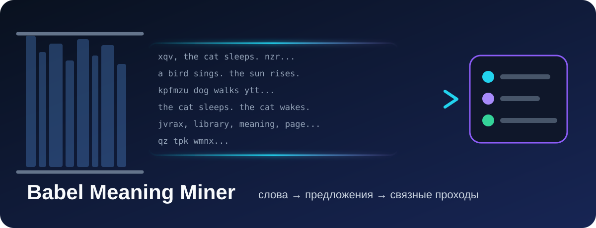
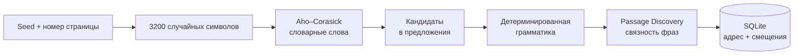
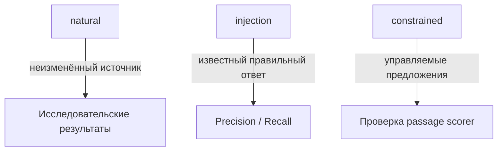

# Babel Meaning Miner v0.3


<p align="center">
  
</p>

> А что, если генерировать страницы «Вавилонской библиотеки» и методично искать в шуме слова, правильные предложения и несколько связанных фраз подряд?

BMM — исследовательская CLI-программа на C++20. Она генерирует воспроизводимые страницы, находит слова, проверяет ограниченную английскую грамматику и выделяет фрагменты из нескольких подряд идущих предложений. Результаты сохраняются в SQLite вместе с исходными адресами, смещениями, режимом источника и оценками. Локальному движку интернет не нужен.

## В чём прикол

Каждая страница состоит из 3200 символов и воспроизводится по паре `seed + номер страницы`. BMM прогоняет её через несколько фильтров: сначала ищет словарные слова, затем непрерывные цепочки слов, проверяет грамматику и, наконец, оценивает соседние предложения как единый фрагмент.



Главная идея проекта не в обещании быстро найти роман в случайном шуме. Наоборот, BMM честно считает вероятность такого события, показывает, почему длинные осмысленные фрагменты невероятно редки, и предоставляет отдельные контролируемые режимы для проверки самого детектора.

| Режим | Что происходит | Можно назвать случайной находкой? |
|---|---|---|
| `natural` | Страница целиком создаётся локальным генератором | Да |
| `injection` | Известная фраза вставляется в шум для проверки обнаружения | Нет, это тест |
| `constrained` | Страница строится из конечной грамматики | Нет, это эксперимент |



Программа не дорисовывает знаки препинания и не склеивает удалённые строки. Для каждой находки сохраняются точный адрес страницы, начало, конец, исходный текст и режим происхождения.

## Быстрый запуск на Windows

Из папки проекта:

```powershell
cd E:\Babel
.\bmm
```

Откроется русское меню. Короткие команды:

| Команда | Действие |
|---|---|
| `.\bmm q` | Быстрый поиск слов на 1 000 страницах |
| `.\bmm s 50000 4` | Поиск слов: 50 000 страниц, 4 потока |
| `.\bmm ss 10000 4` | Поиск предложений |
| `.\bmm pp 10000` | Поиск последовательных предложений |
| `.\bmm pass` | Фрагменты последнего эксперимента |
| `.\bmm sp "the cat sleeps. the cat wakes."` | Оценка введённого фрагмента |
| `.\bmm chance 1000000000` | Расчёт осуществимости поиска на миллиарде страниц |
| `.\bmm eval` | Проверка на явно синтетических внедрениях |
| `.\bmm words` / `.\bmm fw` | Найденные слова и количество повторений |
| `.\bmm fs` | Принятые одиночные предложения и количество повторений |
| `.\bmm phrases` / `.\bmm fp` | Совпадения из двух и более соседних слов и их частота |
| `.\bmm custom` / `.\bmm c` | Свой объём страниц, режим поиска и число потоков |
| `.\bmm f` / `.\bmm st` | Находки / статистика последнего эксперимента |
| `.\bmm r` | Обработать ещё 10 000 страниц последнего эксперимента |
| `.\bmm x` | Экспорт находок последнего эксперимента |
| `.\bmm b` / `.\bmm t` | Сборка / сборка и CTest |
| `.\bmm help` | Справка по коротким командам |

Лаунчер v0.3 использует отдельную базу `data/bmm-v03.db` и файл `.bmm-v03-last-experiment`. Старые базы при обновлении не изменялись; прежняя `data/bmm.db` автоматически не подхватывается. `bmm.ps1` сохранён в UTF-8 с BOM для корректного чтения русского текста Windows PowerShell 5. Не удаляйте BOM при редактировании.

Пример результата в человекочитаемом CLI:

```text
Лексическое сканирование
  Эксперимент:       2
  Режим источника:   natural
  Статус:            completed
  Обработано страниц:       1 000
  Скорость:               5 466,2 стр./с
  Сохранено находок:           23

Найденные слова
    1.      6 ×  cat
    2.      3 ×  library
```

Если `build/bmm.exe` отсутствует, лаунчер пытается собрать проект. Компилятор C++20 и CMake должны быть установлены. После изменения исходников выполните `.\bmm b` или `.\bmm t`.

## Сборка

Требуются CMake 3.20+ и компилятор C++20 с потоками. Используется системная SQLite3 либо поставляемый исходный код SQLite 3.54.1. Загрузка зависимостей при конфигурации не требуется.

```sh
cmake -S . -B build -DCMAKE_BUILD_TYPE=Release
cmake --build build --config Release
ctest --test-dir build -C Release --output-on-failure
```

Для Ubuntu: `sudo apt install build-essential cmake libsqlite3-dev`. Для Windows подойдут настроенное окружение MSVC или совместимый C++20 toolchain. При многоконфигурационном генераторе исполняемый файл может находиться в `build/Release`; текущий простой лаунчер ориентирован на `build/bmm.exe`. Дополнительные тесты CLI и семантического адаптера требуют Python 3; список зарегистрированных тестов показывает `ctest --test-dir build -N`.

## Полный CLI

Примеры используют новую базу `runs/example-v03.db`. В Linux замените `.\build\bmm.exe` на `./build/bmm`.

```powershell
.\build\bmm.exe scan --backend local --mode passages --pages 10000 --threads 4 --seed 4242 --min-sentences 2 --db runs/example-v03.db --json
.\build\bmm.exe passages --experiment 1 --sort coherence --limit 20 --db runs/example-v03.db
.\build\bmm.exe passage --id 1 --db runs/example-v03.db
.\build\bmm.exe stats --experiment 1 --db runs/example-v03.db
.\build\bmm.exe export --experiment 1 --type passages --format json --output runs/passages.json --db runs/example-v03.db
.\build\bmm.exe integrity --db runs/example-v03.db
.\build\bmm.exe resume --experiment 1 --pages 10000 --threads 4 --db runs/example-v03.db --json
```

В `resume --pages N` число `N` означает **дополнительные страницы после сохранённой контрольной точки**, а не желаемый общий размер эксперимента. Прервать сканирование можно `Ctrl+C`: уже взятые блоки завершаются, затем сохраняется согласованный прогресс. Блок по умолчанию — 1000 страниц, окно незаписанных блоков — 8; доступны `--batch-size` и `--queue-capacity`.

Восстанавливаются сохранённые параметры источника и анализа. Изменение словаря, POS-лексикона или модели обнаруживается по отпечаткам. Старые эксперименты с неполной конфигурацией нельзя безопасно продолжить как v0.3. Миграция схем добавочная, но открытие старой базы новым хранилищем выполняет запись схемы: для изучения архива сначала работайте с его копией.

`--mode words|sentences|passages` выбирает анализ. В sentence/passage-режимах отдельные слова учитываются в счётчиках, но по умолчанию не сохраняются; `--store-words` включает их запись. Файл `config/default.json` — справочник значений, **CLI его автоматически не загружает**.

## Источники и смысл результатов

| `--source-mode` | Назначение |
|---|---|
| `natural` | Неизменённые страницы SplitMix64; только эти находки считаются спонтанными |
| `injection` | Известный текст из `--text` вставляется в случайное окружение для проверки детектора |
| `constrained` | Предложения из конечного набора грамматических вариантов для проверки связности |

```powershell
.\build\bmm.exe scan --source-mode constrained --sentence-count 3 --mode passages --pages 20 --db runs/constrained-v03.db --json
.\build\bmm.exe evaluate --mode injection
.\build\bmm.exe feasibility --pages 10000 --min-sentences 2
```

Все источники имеют разные метки происхождения. Произвольный текст не имеет обратимого адресного отображения в текущий SplitMix64-генератор; targeted address search не реализован. Адрес `local:<seed>:<index>` воспроизводится вместе с версией генератора, размером страницы и алфавитом из конфигурации. Он не является адресом оригинальной Library of Babel.

`GRAMMATICAL_SENTENCE` означает прохождение реализованных правил. `COHERENT_PASSAGE` означает прохождение поверхностных эвристик связности, а не установленную смысловую согласованность. Полная английская грамматика и универсальная семантика не реализованы. Ограничения поиска описаны в [FEASIBILITY.md](docs/FEASIBILITY.md), реальные измерения и нулевые результаты — в [EXPERIMENT_REPORT_V03.md](docs/EXPERIMENT_REPORT_V03.md).

## Языковая модель и локальный ИИ

Обучение использует предоставленный пользователем текстовый корпус с правами на его использование:

```powershell
.\build\bmm.exe train-language-model --corpus corpus.txt --output models/english.ngram
.\build\bmm.exe evaluate-language-model --model models/english.ngram --corpus heldout.txt
.\build\bmm.exe score-text --text "the dog sees a cat" --model models/english.ngram
.\build\bmm.exe score-passage --text "the cat sleeps. the cat wakes." --model models/english.ngram
```

Без модели используется явно обозначенный `baseline-untrained`; он не выдаёт обученные языковые вероятности. Формат модели v0.3 изменён: старые `.ngram` нужно переобучить. `data/evaluation` содержит авторские синтетические MIT-фикстуры для тестов; это не натуральный корпус и не найденный в случайных страницах текст. Большие корпуса и модели не скачиваются.

Опциональный `scripts/validate_semantics.py` отправляет только отобранные фрагменты уже установленной модели Ollama на локальном HTTP-адресе:

```powershell
py -3 scripts/validate_semantics.py --input runs/passages.json --output runs/semantic-review.jsonl --model ИМЯ_УСТАНОВЛЕННОЙ_МОДЕЛИ --workers 1 --batch-size 8 --timeout 30
```

Результат сохраняется отдельным JSONL, исходный текст и база не изменяются. Ответ проверяется по схеме, кэш привязан к тексту и digest модели. Оценка LLM остаётся мнением модели. Живой запуск Ollama не подтверждён; тесты проверяют контракт HTTP, кэш и ошибки с подставными ответами.

Удалённый оригинальный бэкенд отключён: точное получение страниц и совместимость не подтверждены. История проверок v0.2 и свежая проверка v0.3 разделены в [REMOTE_INTEGRATION.md](docs/REMOTE_INTEGRATION.md).

Алгоритмы: [SENTENCE_ENGINE.md](docs/SENTENCE_ENGINE.md). Модули, контрольные точки и будущий API: [ARCHITECTURE.md](docs/ARCHITECTURE.md).
